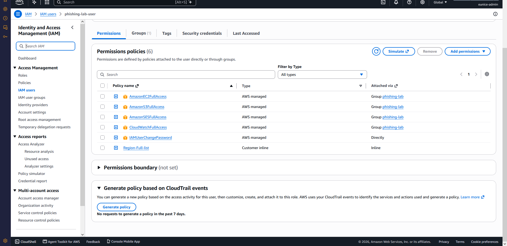
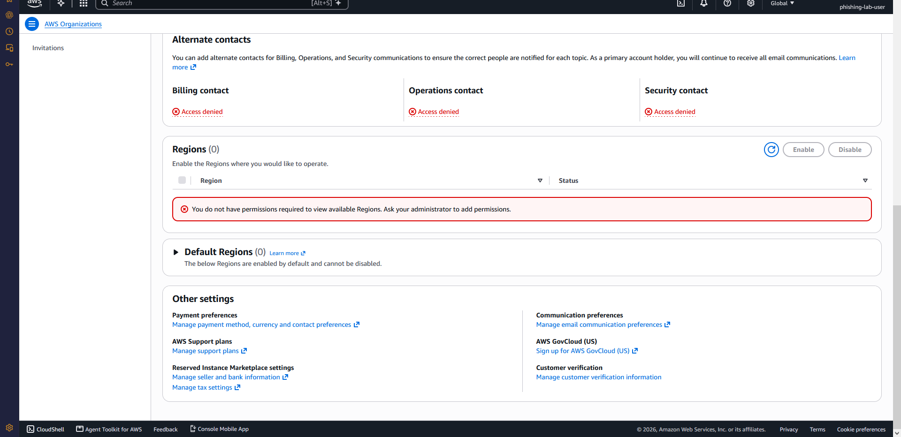
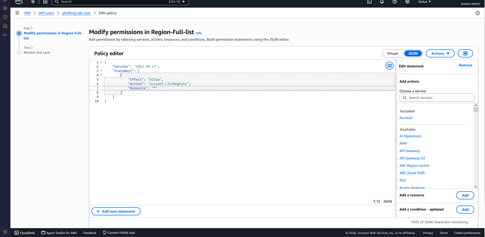
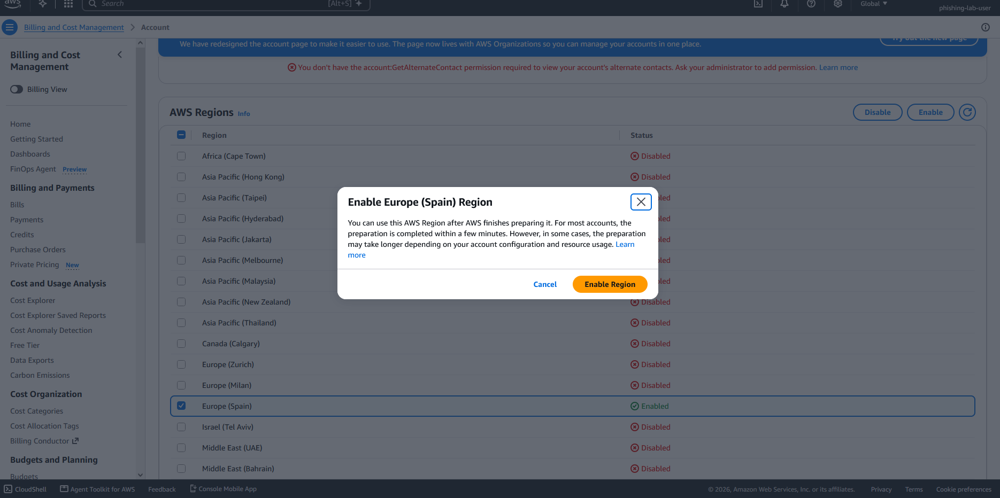
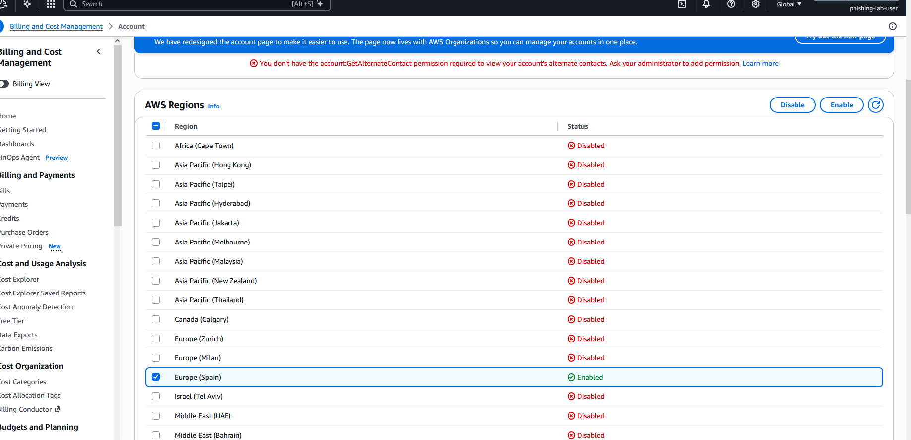

# Phishing Simulation Lab on AWS — Part 1: Secure IAM Foundation

A hands-on home lab building a safe, permission-based phishing simulation on AWS using GoPhish.
This first part covers the **Identity and Access Management (IAM) foundation** — setting up
least-privilege access *before* launching a single server.

> **Ethics note:** This lab sends simulated phishing emails only to test inboxes I own and have
> verified. No real people are targeted. Any real-world awareness exercise would require written
> authorisation and an agreed scope from the organisation involved.

---

## Goals of Part 1

- Apply the **principle of least privilege** from the very first step.
- Separate a powerful **admin** identity from a scoped **lab** identity.
- Practise core AWS Certified Cloud Practitioner topics: IAM users, groups, policies, the
  global-vs-regional distinction, and opt-in Regions.

---

## Why not just use the root or admin account?

The AWS **root user** can do anything and should be locked away, used only for a handful of
account-level tasks. Day-to-day work should happen through IAM identities with only the
permissions they need. So this lab uses two separated identities:

| Identity | Role | Permissions |
|---|---|---|
| `admin` user | Account setup and administration | `AdministratorAccess` |
| `phishing-lab-user` | Runs the lab only | EC2, S3, SES, CloudWatch (via a group) |

If the lab user's credentials ever leaked, the blast radius is capped at four services —
never the whole account.

---

## Step 1 — Create a scoped group

Rather than attaching permissions to a user one by one, I created a **group** and attached the
policies to it. Any user placed in the group inherits those permissions, and updating the group
updates every member at once.

**Group:** `phishing-lab`
**Attached AWS-managed policies:**

| Policy | Why it's needed |
|---|---|
| `AmazonEC2FullAccess` | Run the GoPhish server |
| `AmazonS3FullAccess` | Host the awareness landing page |
| `AmazonSESFullAccess` | Send the simulation emails |
| `CloudWatchFullAccess` | Monitor metrics and logs |

> `CloudTrail` was deliberately **left out**: account activity is already recorded by default,
> and the lab user has no need to manage it.

---

## Step 2 — Create the lab user

**User:** `phishing-lab-user`
- Console access: **enabled** (so I can work visually in the browser)
- Added to the `phishing-lab` group
- CLI access key: **skipped** (see below)

The permissions below show the four service policies inherited **via the `phishing-lab` group**,
plus `IAMUserChangePassword` (added automatically with console access) and the small inline policy
from Step 4.



---

## Step 3 — Least privilege, proven in practice

This is the most valuable part of the exercise. Working as the scoped lab user, I hit several
walls — each one is least privilege doing exactly its job:

1. **Couldn't create its own access key.** Creating keys is an IAM action, and the lab group has
   no IAM permissions. So I skipped the CLI key entirely — the whole lab runs through the console
   and via SSH into the server, neither of which needs one.

2. **Couldn't list AWS Regions.** The console Region switcher calls `account:ListRegions`, which
   the lab group didn't have.

3. **Couldn't view account-level pages** — alternate contacts (`account:GetAlternateContact`) and
   the available-Regions list in AWS Organizations both returned *access denied*, because those
   are account-level permissions the lab user shouldn't hold.



---

## Step 4 — The one small permission the lab user *does* need

To let the lab user **see and switch** Regions in the console, I added a minimal, read-only
inline policy granting just `account:ListRegions` — nothing more.

```json
{
  "Version": "2012-10-17",
  "Statement": [
    {
      "Effect": "Allow",
      "Action": "account:ListRegions",
      "Resource": "*"
    }
  ]
}
```

> **Lesson:** least privilege is not "give as little as possible and stop" — it's "give exactly
> what the task needs." A read-only `ListRegions` is safe; `account:EnableRegion` or
> `DisableRegion` would not be, so those stay with the admin.



---

## Step 5 — Global vs regional, and opt-in Regions

A couple of core exam concepts showed up naturally:

- **IAM is global.** Users, groups and policies exist account-wide; the Region selector has no
  effect on them.
- **Most services are regional.** EC2 and SES only appear in the Region you select.
- **Europe (Spain) `eu-south-2` is an opt-in Region.** Opt-in Regions are disabled by default and
  must be enabled by an account-level identity (`account:EnableRegion`). I enabled Spain as the
  **admin** user — not by widening the lab user — to keep the scoped setup clean.

Choosing the Spain Region keeps the lab server physically close to its intended users, reducing
latency.





---

## What's next — Part 2

- Add MFA to the lab user
- Launch a free-tier Ubuntu EC2 instance in `eu-south-2`
- Lock the security group down to my own IP
- Install and configure GoPhish
- Send a safe simulated campaign to verified test inboxes
- Build an S3 awareness landing page and report the results

---

## Key takeaways

- Separate admin and task identities from day one.
- Attach permissions to **groups**, not individual users.
- Expect, and welcome, "access denied" when testing a scoped user — it's proof the boundary works.
- Grant the *exact* read-only permission a task needs, no more.
- Know which services are global (IAM) and which are regional (EC2, SES).

*Part of my cybersecurity portfolio — LindfoSec.*
